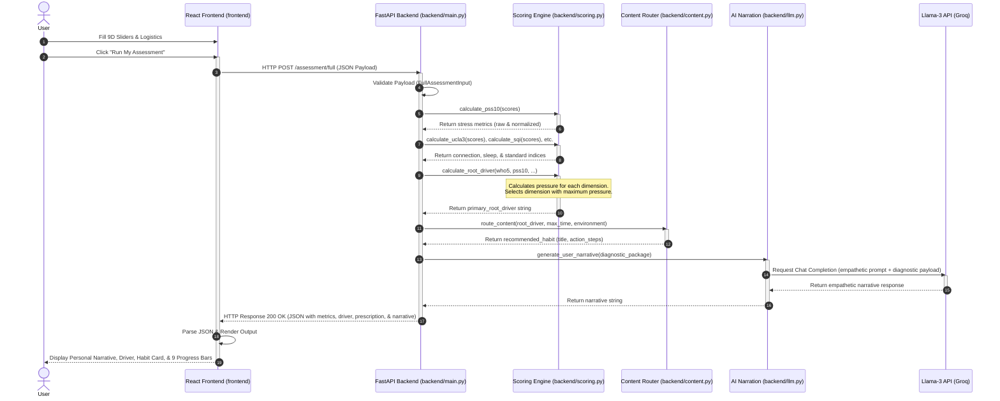
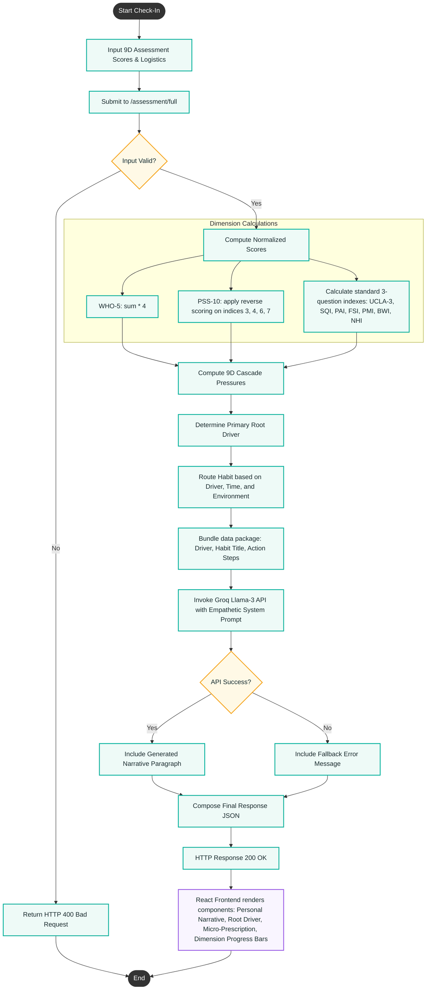

# LEWIS Core Engine - Workflow UML Diagrams

This document contains formal UML representations of the **LEWIS Core Engine** workflow. It details how inputs are collected, how calculations and matrix diagnostics are processed in the backend, and how AI-driven narration is integrated.

---

## 1. UML Sequence Diagram
This diagram shows the chronological order of interaction and message-passing between the user, the frontend, the FastAPI backend, scoring engine modules, habit routing modules, and the Groq LLM wrapper.

---

## 2. UML Activity Diagram
This activity diagram models the control flow, decisions, and sequential calculations performed within the engine from start to end.

